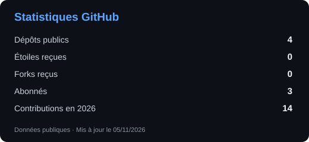
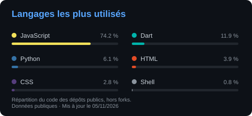
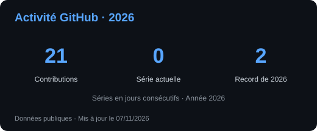

# Salut, moi c'est Nicolas 👋

### Développeur Full Stack | Java & Vue.js

🎓 Étudiant en dernière année de Master Ingénierie du Web  
💼 Développeur Full Stack en alternance chez **Orange Business** à Tours  
🚀 Passionné par le développement web et les architectures logicielles

---

## 👨‍💻 À propos de moi

Développeur Full Stack en alternance chez **Orange Business**, je participe à la conception, au développement et à la maintenance d'applications web professionnelles.

Je travaille principalement avec **Java, Spring Boot, Vue.js et TypeScript**, dans un environnement Agile.

J'aime concevoir des solutions performantes, maintenables et évolutives, tout en continuant à approfondir mes compétences techniques.

- 💼 **Entreprise :** Orange Business — Tours
- 🎓 **Formation :** Master Ingénierie du Web — ESGI Rennes
- 💻 **Spécialisation :** Développement Full Stack
- 🌱 **Stack actuelle :** Java 21, Spring Boot, Vue 3, TypeScript
- 🎯 **Intérêts :** Architecture logicielle, API REST, DevOps et qualité du code

---

## 🛠️ Stack technique

### Langages

### Frontend

### Backend

### Bases de données

### Outils & DevOps

---

## 📊 Statistiques GitHub

<!-- Cartes générées chaque jour par .github/workflows/profile-stats.yml. -->

---

## 🤝 Me contacter

Je suis toujours intéressé par les échanges autour du développement web, des nouvelles technologies et des projets innovants.

📧 **Email :** [nicolasbellina72@gmail.com](mailto:nicolasbellina72@gmail.com)

💼 **LinkedIn :** [Nicolas Bellina](https://www.linkedin.com/in/nicolas-bellina-a35252252/)

---

*Merci de votre visite !* 🚀

